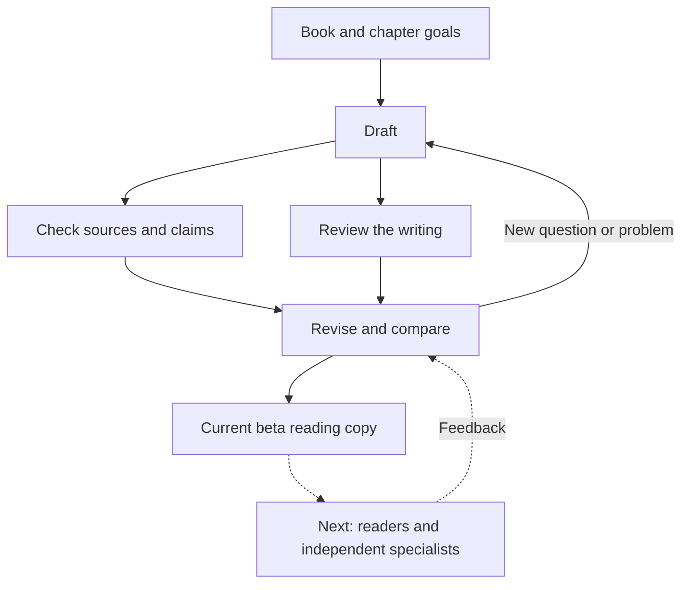

# Creatures of Context

**An exploration of writing nonfiction with AI.**

Many people are uncomfortable with the idea of an AI-written book. I understand why. It raises questions about who is doing the writing, whether the information is reliable, and what we value in a book. I still wanted to explore what was possible and share an honest account of the work.

AI did a substantial amount of drafting and rewriting, helped research and check sources, and produced the reading editions. My role was to choose the subject and direction, question the results, and ask for revisions. This project contains the current book, examples of changes, and some tools and lessons from the process.

## The book

*Creatures of Context: How Biology and the Modern World Shape What We Fear, Want, and Value* looks at how our bodies, experiences, and surroundings shape behavior. It moves from stress and reward through sleep, relationships, and habits, then into meaning, cooperation, and the conditions we create for others.

**Beta reading copy · 14 chapters · about 22,100 words · 63 source notes**

[Read in Markdown](output/Creatures_of_Context.md) · [Download PDF](output/Creatures_of_Context.pdf) · [Download EPUB](output/Creatures_of_Context.epub)

## How we got here

We had a chapter plan and a central argument. Some of the work followed that plan. A lot came from looking at a draft, noticing something wasn't working, and asking another question.

After the first complete draft, I asked for separate reviews of the structure, citations, and writing. We also compared selected passages with an accessible nonfiction excerpt. That helped explain why parts of our book still felt like a textbook: it often summarized the interesting part before the reader had a chance to discover it.

As problems became clearer, we made the editing instructions more specific. Roughly, the work looked like this:

The [full process account](methods/WORKFLOW.md) explains what was planned, what grew out of feedback, and which steps we could record and repeat.

## What we learned

- **A complete draft can still need serious work.** The assistant sometimes called the book finished too early. Later reviews found problems with both the explanations and the writing.
- **Specific feedback gave us something to fix.** “Make it more human” became “stay with this example,” “show what the researchers did,” and “cut the explanation the reader no longer needs.”
- **Better storytelling creates more things to check.** Adding detail to an experiment means checking that detail. An invented scene can explain an idea, but its outcome cannot prove the idea works.
- **Keep one master copy.** Our reading editions and working revisions fell out of step. We brought the chapters together and used scripts to make all three reading formats from the same files.

The larger challenge was keeping a whole book interesting and connected while staying within what the research supported. We made changes we can explain and show; readers still need to tell us whether they work.

## One example

In this fictional reading-group scene, the earlier version explains that a relationship has developed. The revision lets a remembered book start a second conversation.

Two more examples

[Read the excerpts and why we changed them](methods/WORKED_EXAMPLES.md).

## What the editing skill does

The included [Human Science Prose Editor](skills/edit-human-science-prose/SKILL.md) is a set of saved instructions for an AI assistant. It can guide a review, an edit, or a comparison of voice across chapters.

It asks the assistant to work out what a passage needs to do, identify what must survive the edit, then check the revision against the original. For example, making a sentence smoother must not quietly change “was associated with” into “caused.”

The skill helps carry useful instructions into the next task. Its checks do not guarantee accuracy or good writing. [How to use it](docs/USING_THE_SKILL.md).

You can also inspect the [recorded edits](records/STYLE_CHANGES.json), [source checks](records/EVIDENCE_CHANGES.md), and [evidence-record template](templates/EVIDENCE_RECORD.md), or follow the [build instructions](docs/BUILD.md) to generate the reading editions.

## What comes next

The complete beta is available for reader feedback. A full claim-by-claim evidence review and independent specialist review are still needed too.

Useful feedback points to a passage: where you became interested, started skimming, got confused, or found something the source does not support. [Current status](docs/STATUS.md) · [Next steps](docs/ROADMAP.md).

---

Maintained by [whatifqu3stion](https://github.com/whatifqu3stion). The editing skill retains its [MIT license](skills/edit-human-science-prose/LICENSE) and attribution to Peter Yang's `no-ai-slop` project. The manuscript and other project materials do not currently have a general reuse license.
